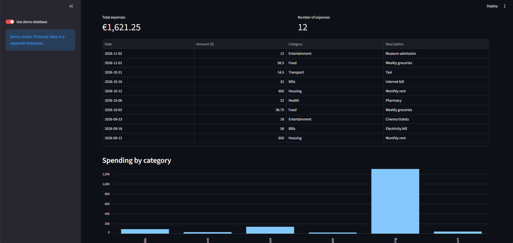
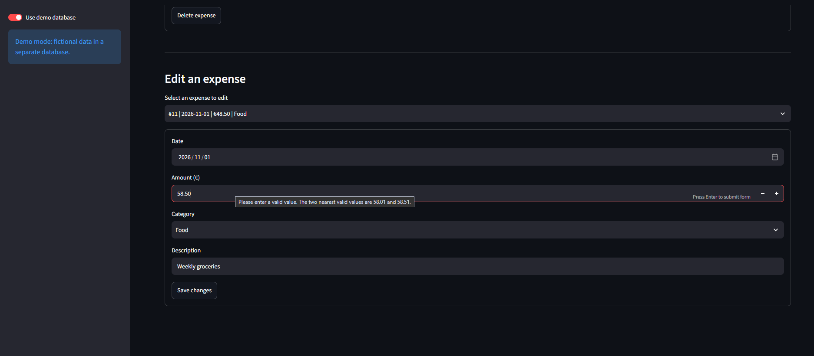

# Expense Tracker

A local expense management application built with Python, Streamlit
and SQLite. Users can record expenses, update entries, analyse spending
and export filtered data to CSV.

## Screenshots

### Dashboard



### Edit an expense



## Features

- Add expenses with a date, amount, category and description.
- Edit existing expenses.
- Delete individual expenses with confirmation.
- Filter expenses by month and category.
- View total spending and the number of matching expenses.
- Visualise spending by category.
- Export filtered expenses to CSV.
- Switch between personal and demo databases.
- Store data locally using SQLite.

## Technology Stack

- Python
- Streamlit
- pandas
- SQLite
- unittest

The dependency versions used for local development are recorded
in `requirements.txt`.

## Design Decisions

- Monetary amounts are stored as integer euro cents to avoid
  floating-point rounding errors in storage.
- SQL statements use parameters for user-supplied values.
- Database connections are managed with a context manager that
  handles transactions and closes connections after use.
- Demo data is stored separately from personal expenses.
- CSV exports neutralise common spreadsheet formula prefixes
  in user-entered descriptions.

## Requirements

- Python with the built-in `sqlite3` module.
- pip.

The application was developed and tested locally using Python 3.14.

## Installation

Clone or download the repository, then open a terminal in the
project folder.

### Windows

```powershell
python -m venv .venv
.\.venv\Scripts\python.exe -m pip install -r requirements.txt
.\.venv\Scripts\python.exe -m streamlit run app.py
```

### macOS / Linux

```bash
python3 -m venv .venv
./.venv/bin/python -m pip install -r requirements.txt
./.venv/bin/python -m streamlit run app.py
```

Open the local URL displayed in the terminal.

The personal database is created automatically on first use.

## Demo Data

To create fictional sample expenses, run:

### Windows

```powershell
.\.venv\Scripts\python.exe seed_demo.py
```

### macOS / Linux

```bash
./.venv/bin/python seed_demo.py
```

Then enable **Use demo database** in the application's sidebar.

The demo database contains 12 initial expenses across three months.
Running the script again leaves an existing non-empty demo database
unchanged.

You can add, edit and delete demo expenses without changing the
personal database.

## Tests

The database test suite uses a temporary database for each test
and does not modify personal or demo expenses.

### Windows

```powershell
.\.venv\Scripts\python.exe -m unittest -v test_database
```

### macOS / Linux

```bash
./.venv/bin/python -m unittest -v test_database
```

The seven tests cover:

- Adding and reading an expense.
- Updating an expense.
- Deleting only the selected expense.
- Deleting a nonexistent expense.
- Updating a nonexistent expense.
- Rejecting zero and negative amounts.
- Storing descriptions containing SQL-like text safely.

All seven tests passed in the local Windows development environment.

## Project Structure

| File / folder | Purpose |
|---|---|
| `app.py` | Streamlit interface, filters, charts and CSV export |
| `database.py` | SQLite connection management and database operations |
| `seed_demo.py` | Creates fictional demo expenses |
| `test_database.py` | Automated database tests |
| `requirements.txt` | Pinned application dependencies |
| `screenshots/` | Application screenshots |
| `.gitignore` | Excludes local environments and databases |
| `data/` | Locally generated databases; excluded from version control |

## Scope and Limitations

This project is intended for local, single-user use.

It does not include authentication or multi-user data isolation.
Database selection uses shared module state, so the current
implementation should not be deployed as a public multi-user service.

Local database files are excluded from version control. Users are
responsible for backing up their own data.

CSV export is supported; CSV import is not currently implemented.

## Future Improvements

- Add CSV import with validation.
- Add monthly budgets and spending comparisons.
- Expand input validation and automated interface tests.
- Refactor database selection to support isolated user sessions.

## Author

Emmanouil Koutsokostas